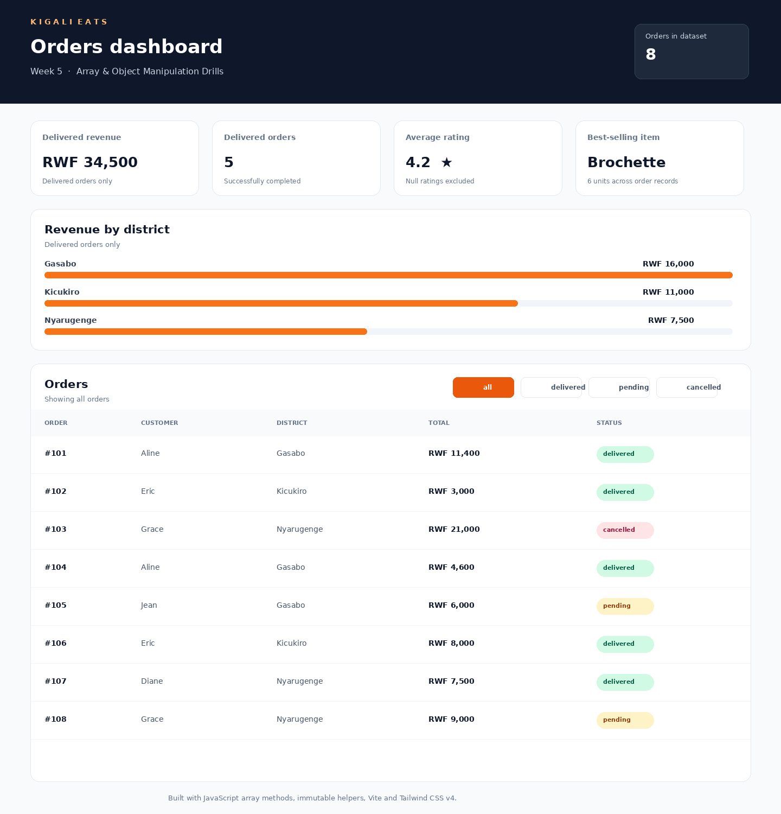

# Week 5 — Array & Object Manipulation Drills

A JavaScript workshop project using the Kigali Eats orders dataset. It contains 25 numbered drill solutions and a responsive Vite + Tailwind CSS v4 dashboard.

## Features

- Array practice with `map`, `filter`, `find`, `some`, `every`, `Set`, and spread
- Calculations with `reduce` and `flatMap`
- Grouping with `Object.groupBy`, `Object.entries`, and `Object.fromEntries`
- Ranking with `toSorted`
- Immutable nested updates using object and array spread
- Dashboard statistic cards, revenue bars by district, order table, and status filters
- Original dataset immutability check

## Requirements

Use a recent Node.js version that supports `Object.groupBy()` and `Array.prototype.toSorted()` (Node.js 22 or newer is recommended).

## Run the drills

```bash
npm install
node drills.js
```

The final immutability check should print:

```text
Original orders unchanged: true
```

## Run the dashboard

```bash
npm install
npm run dev
```

Open the local URL printed by Vite in your terminal.

To test a production build:

```bash
npm run build
npm run preview
```

## File structure

```text
week5-array-object-drills/
├── data.js
├── drills.js
├── helpers.js
├── index.html
├── package.json
├── vite.config.js
├── README.md
└── src/
    ├── main.js
    └── style.css
```

## Important calculation choices

- **Revenue** and **revenue by district** include delivered orders only, because cancelled and pending orders have not been completed.
- **Average rating** ignores `null` ratings.
- **Brochette quantity** and **best-selling items** count the items in all supplied order records, following the drill wording.
- **Customer spend** sums the value of all of that customer's supplied orders, regardless of status. If your instructor defines spend as delivered orders only, add a delivered-status filter before summarising customers.
- Discounted item prices are rounded to the nearest whole number.

## Immutability

The original `orders` array is never edited by the helper functions. Functions that update data return new arrays and copy the changed order, nested customer, items array, or item objects as needed. `rateOrder` returns the original array reference when the target order is missing or is not delivered, as required by the instructions.

## Dashboard notes

The dashboard uses a small local, trusted dataset, so its table is rendered with `map()`, template literals, and `join("")`. The `innerHTML` use is explicitly commented in `src/main.js` as requested by the workshop. Do not use this pattern with untrusted user input.

## Dashboard screenshot



## Score and verification

- **Self-check score: 25/25 exercises are included** in `drills.js`, numbered 1–25 with each solution under a numbered comment.
- **Runtime check:** `node drills.js` completes and prints `Original orders unchanged: true`.
- **Official instructor score:** not yet assigned; replace this line with the score given by your instructor when available.
- **Production build:** not verified in this environment because installing the Vite dependencies timed out. Run `npm install` and `npm run build` locally before final submission.

## Submission checklist

- [x] `data.js` dataset included.
- [x] `drills.js` contains 25 numbered solutions.
- [x] Dashboard files included (`index.html`, `src/main.js`, `src/style.css`, `helpers.js`, and Vite config).
- [x] README includes dashboard screenshot and clearly labelled self-check score.
- [ ] Push to a public GitHub repository named `week5-array-object-drills`.
